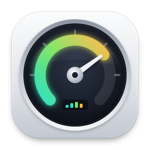
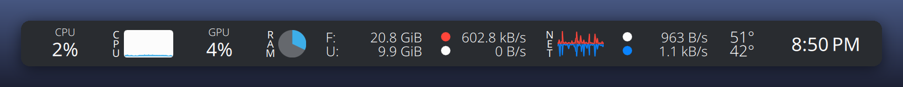
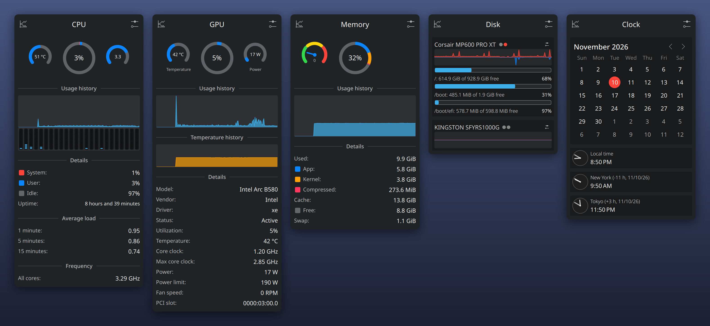

# Readout

<p align="center"></p>




System monitor for the KDE Plasma and GNOME Shell panels, inspired by [Stats](https://github.com/exelban/stats) for macOS.

## Installation

### Fedora

Build the RPMs from the spec in this repository, then install them:

```bash
sudo dnf install rpm-build git
sudo dnf builddep packaging/fedora/readout.spec
mkdir -p ~/rpmbuild/SOURCES
git archive --prefix=readout-0.1.0/ -o ~/rpmbuild/SOURCES/readout-0.1.0.tar.gz HEAD
rpmbuild -ba packaging/fedora/readout.spec
```

Install the daemon and the frontend for your desktop:

```bash
# KDE Plasma
sudo dnf install ~/rpmbuild/RPMS/x86_64/readout-0.1.0-*.rpm ~/rpmbuild/RPMS/x86_64/plasma-applet-readout-0.1.0-*.rpm

# GNOME
sudo dnf install ~/rpmbuild/RPMS/x86_64/readout-0.1.0-*.rpm ~/rpmbuild/RPMS/noarch/gnome-shell-extension-readout-0.1.0-*.rpm
```

### Ubuntu and Debian

Ubuntu 26.04 or later has the Plasma and GNOME versions Readout needs.
On Debian 13, only the daemon and the GNOME extension build, because its Plasma is older than 6.4; use the *From source* steps with `-DREADOUT_BUILD_PLASMA=OFF` there.

```bash
sudo apt install devscripts equivs
cp -r packaging/debian debian
sudo mk-build-deps --install --remove debian/control
dch --create --package readout --newversion 0.1.0-1 --distribution unstable "Local build."
dpkg-buildpackage -us -uc -b
```

Then install `../readout_0.1.0-1_*.deb` together with `../plasma-widget-readout_*.deb` or `../gnome-shell-extension-readout_*.deb` using `sudo apt install ./file.deb`.

### From source

Any distribution with systemd works.
Install the build dependencies first:

```bash
# Fedora
sudo dnf install cmake ninja-build gcc-c++ systemd-devel gtest-devel dbus-daemon hwdata \
    extra-cmake-modules qt6-qtbase-devel qt6-qtdeclarative-devel \
    kf6-ki18n-devel kf6-kcoreaddons-devel kf6-kconfig-devel kf6-knotifications-devel \
    kf6-kquickcharts-devel kf6-kirigami-devel kf6-kcmutils libplasma-devel glib2-devel gettext

# Debian and Ubuntu
sudo apt install devscripts equivs
sudo mk-build-deps --install --remove packaging/debian/control

# Arch Linux
sudo pacman -S --needed cmake ninja gcc pkgconf python systemd gtest dbus hwdata \
    extra-cmake-modules qt6-base qt6-declarative ki18n kcoreaddons kconfig knotifications \
    kcmutils kquickcharts kirigami libplasma glib2 gettext
```

Then build, test and install:

```bash
cmake -S . -B build -G Ninja -DCMAKE_INSTALL_PREFIX=/usr
cmake --build build
ctest --test-dir build
sudo cmake --install build
```

Leave out a desktop with `-DREADOUT_BUILD_PLASMA=OFF` or `-DREADOUT_BUILD_GNOME=OFF`.

### Adding it to the panel

- **KDE Plasma:** right-click the panel, choose *Add Widgets…*, and add *Readout*.
- **GNOME:** log out and back in, then run `gnome-extensions enable readout@aakash1122.github.io`.

## Requirements

- Linux with systemd
- KDE Plasma 6.4 or later, or GNOME Shell 48 or later
- Optional: NetworkManager (Wi-Fi details), UPower (battery), BlueZ (Bluetooth), UDisks2 (disk health), the NVIDIA driver (NVIDIA GPUs)

## Features

Readout is a set of panel widgets that let you monitor your Linux system.

- CPU utilization, temperature and frequency, with performance and efficiency cores on hybrid CPUs
- GPU utilization, temperature, memory, clocks, power and fan speed (AMD, Intel and NVIDIA)
- Memory usage, pressure and swap
- Disk usage, read and write speed, and drive health
- Network usage, connection and Wi-Fi details
- Battery level, health and power draw, including mice, keyboards and headsets
- Sensors information (temperature, voltage, current, power and fans)
- Bluetooth devices
- Multiple time zone clock
- Top processes for CPU, memory and disk
- Alerts for high usage, high temperature, low disk space, low battery and lost connection

Every module has several panel styles, from plain text to charts, bars, pies and gauges.
Several modules can share one panel item; its popup then shows a summary of each.

## FAQs

### How do I show several modules?

On Plasma, add the Readout widget once for every module you want, or pick several modules in one widget's settings.
On GNOME, add panel items in the extension preferences; each item can show one or more modules.

### How do I change the order of the panel items?

On Plasma, enter Edit Mode (right-click the panel, then *Enter Edit Mode*) and drag the widgets.
On GNOME, open the extension preferences: *Move Up* and *Move Down* set the order of the items, and *Position* puts them on the left, center or right of the top bar.

### How much does Readout cost to run?

Very little.
One small service, `readoutd`, reads the system for every widget, so ten panel items cost the same as one.
It reads only what is on screen: per-core data, process lists and disk health are read only while a popup is open.
It starts when a widget needs it and exits 30 seconds after the last one goes away.
A sleeping discrete GPU is never woken up to read it.

With three panel items at a 2 second interval, `readoutd` uses about 0.02% of one CPU core and under 1.5 MiB of memory.
The full measurements are in [docs/perf.md](docs/perf.md).

### The widget says "Cannot reach readoutd". What should I do?

Check that the service starts and that it can read your system:

```bash
systemctl --user status readoutd
readoutctl info
```

If `readoutctl info` works but the widget still cannot connect, log out and back in so the session picks up the new D-Bus service.
If it still fails, please open an issue with the output of both commands.

### Why does my GPU show "Sleeping"?

Laptops power down the discrete GPU when nothing uses it.
Reading its sensors would wake it and drain the battery, so Readout shows it as sleeping instead.

### Why are there no NVIDIA values?

NVIDIA GPUs are read through NVML, which comes with the proprietary NVIDIA driver.
With the open Nouveau driver, only the basic values the kernel exposes are available.

### Why do sensors have names like "Tctl" or "temp1"?

Sensor names come from the Linux kernel drivers.
Readout groups and orders them, but it does not rename them, because the same name can mean different things on different hardware.

### Does Readout send any data?

No.
Readout reads only local system information.
The one exception is the public IP in the network popup, which asks [api.ipify.org](https://www.ipify.org) only when you click *Show*.

## How it works

```
 Plasma widget (QML + C++)          GNOME extension (GJS)
            \                              /
             session D-Bus, unicast Update signals
                           |
                       readoutd
        /proc, /sys, hwmon, NetworkManager, UPower,
          BlueZ, UDisks2, NVML (loaded on demand)
```

`readoutd` is a single-threaded C++23 service built on `sd-bus` and `sd-event`.
Widgets subscribe with the modules they show; detailed data is only read while a popup is open.
The D-Bus API is documented in [docs/dbus-api.md](docs/dbus-api.md), so other frontends can use it too.

## Development

- `ctest --test-dir build` runs the daemon unit tests, an integration test on a private D-Bus session, and the QML lint gate.
- `-DREADOUT_SANITIZE=address,undefined` builds with sanitizers; `-DREADOUT_FUZZ=ON` (Clang) adds a libFuzzer target for the parsers.
- `cd frontends/gnome && npm ci && npx eslint .` lints the GNOME extension.
- `readoutctl watch cpu` prints live values as JSON lines, and `readoutctl once network:detail` prints one detailed sample.

The specifications are in [docs/](docs/): the D-Bus API, the frontend features, the visual design and the GNOME extension.

## Supported languages

- English

The GNOME extension is ready for translation: add `frontends/gnome/po/<language>.po` from `readout.pot` and list the language in `po/LINGUAS`.
Translations are welcome.

## License

[MIT License](LICENSE)
